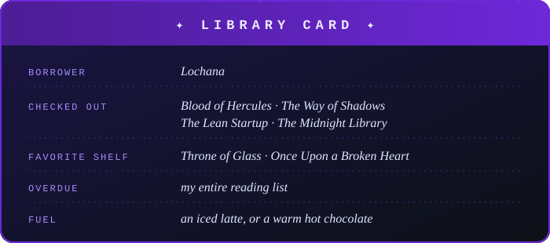

$$\lim_{n \to \infty} \frac{\text{time}}{\text{books}(n)} = 0$$

❄️ a formal proof of my reading list problem ❄️

Hi, I'm **Lochana**! I'm a Computer Science student at **Georgia Tech** who loves building accessible software, from AI-powered hackathon prototypes and Android apps to 3D Roblox games. When I'm not shipping projects, I'm curled up with a good book, going on long walks, crafting miniature books, or playing video games.

> **Lemma:** $\text{shipping} + \text{good book} + \text{long walk} \Rightarrow \text{happy}$
> (debugging and I are still getting to know each other 😅)

 

✦ WHY I BUILD WHAT I BUILD ✦ 
<i>Building and prototyping has never been easier, and with that power comes responsibility. 
I want what I make to work for screen readers and visually impaired users, 
built on clean design principles instead of vibe-coded noise, 
with a UI made for the people who will actually use it.</i>

$$\frac{d}{dt}\,(\text{skills}) > 0$$

🔭 Building accessible web tools and experimenting with AI + deterministic workflows 
🎓 Mentoring high school students on college apps and STEM coursework, 
because everyone deserves someone telling them *"you can absolutely do this"* 💜 
🎮 Always working on a new game idea

 

always down to chat about hackathons, UI/UX, game dev, or anything in between

every square is a day I showed up

 

